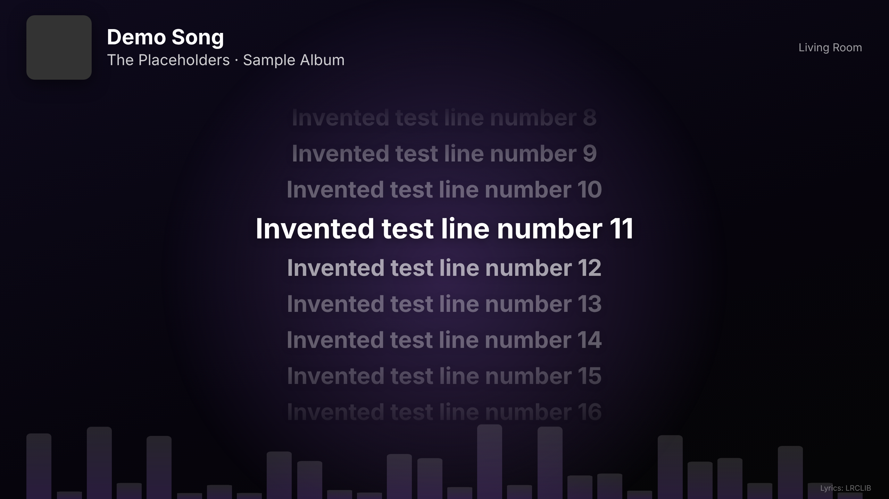

# Lyrics Party Card

Time-synced lyrics for whatever your Home Assistant media player is playing, with album-art colors and party visuals. It's a single JavaScript file with no backend, no API key, and no add-on to run.



## Features

- Synced lyrics that scroll with the song, with auto-scrolling plain lyrics as a fallback
- Follows whichever room is playing, or stays on one player
- Background colors taken from the album art
- Light visuals built to run on a Fire TV Stick
- Card layout for normal dashboards and full-screen layout for TVs
- Optional blueprints that send lyrics to a Fire TV and start a whole-house party mode

## Install

### HACS

1. In HACS, open the menu and choose **Custom repositories**.
2. Add `https://github.com/introy-prog/lyrics-party-card` with the type **Dashboard**.
3. Find **Lyrics Party Card** and download it.
4. Reload your browser.

### Manual

1. Copy `lyrics-party-card.js` to `/config/www/`.
2. Add `/local/lyrics-party-card.js` as a JavaScript module under **Settings > Dashboards > Resources**.

## Usage

Add **Lyrics Party** from the card picker and set it up in the visual editor, or use YAML:

```yaml
type: custom:lyrics-party-card
layout: card
height: 480px
```

For a TV or wall panel, put the card in a **Panel** view:

```yaml
type: custom:lyrics-party-card
layout: fullscreen
visuals: lite
```

| Option | Default | Description |
| --- | --- | --- |
| `entity` | none | Media player to show. Leave it out to follow whatever is playing. |
| `entities` | none | List of players to follow. |
| `layout` | `fullscreen` | `card` or `fullscreen`. Use `fullscreen` only in a Panel view. |
| `height` | `480px` | Card height. Applies to `layout: card`. |
| `offset` | `0.3` | Seconds to shift the lyrics. Raise it if lyrics run late. |
| `visuals` | `full` | `full`, `lite`, or `off`. |
| `font_scale` | `1` | Lyrics size multiplier. |
| `close_path` | `/lovelace` | Where the ✕ goes. Touch screens show it in the `fullscreen` layout. |

Add `?room=media_player.kitchen` to the dashboard URL to lock that screen to one room. Each screen runs on its own, so different rooms can show different songs at the same time. A locked screen shows a waiting message until music starts in that room.

## Send lyrics to a Fire TV

[](https://my.home-assistant.io/redirect/blueprint_import/?blueprint_url=https%3A%2F%2Fgithub.com%2Fintroy-prog%2Flyrics-party-card%2Fblob%2Fmain%2Fblueprints%2Fscript%2Flyrics-party%2Fsend_lyrics_to_fire_tv.yaml)

The blueprint opens your lyrics dashboard on a Fire TV. It runs only when you start it, such as from a dashboard button.

Before you use it, set up each Fire TV:

1. Turn on ADB debugging in the Fire TV developer options.
2. Give the Fire TV a fixed IP address.
3. Install [Fully Kiosk Browser](https://www.fully-kiosk.com/).
4. Add the Fire TV to Home Assistant with the **Android Debug Bridge** integration.
5. Make sure Fully Kiosk can open your dashboard without a login prompt.

Then create a script from the blueprint for each TV. If the Fire TV and a speaker are in the same Home Assistant area, the blueprint pairs them automatically. If an area has more than one speaker, choose the room yourself.

To open the dashboard without a login prompt, you can add the Fire TV's IP address to Home Assistant's [`trusted_networks`](https://www.home-assistant.io/docs/authentication/providers/#trusted-networks) auth provider. Only do this for devices you trust, and give that login a non-admin user.

## Party mode

[](https://my.home-assistant.io/redirect/blueprint_import/?blueprint_url=https%3A%2F%2Fgithub.com%2Fintroy-prog%2Flyrics-party-card%2Fblob%2Fmain%2Fblueprints%2Fscript%2Flyrics-party%2Fparty_mode.yaml)

Party mode groups the speakers you choose, turns on the Fire TVs you choose, and opens the lyrics on every one. It groups around whichever chosen speaker is playing, or the first one in the list. The music keeps playing, and it runs only when you start it. Leave out any TV you don't want turned on.

The Fire TVs need the setup above. Grouping works with players that support it, such as Sonos.

[](https://my.home-assistant.io/redirect/blueprint_import/?blueprint_url=https%3A%2F%2Fgithub.com%2Fintroy-prog%2Flyrics-party-card%2Fblob%2Fmain%2Fblueprints%2Fscript%2Flyrics-party%2Fparty_off.yaml)

The party off blueprint ungroups the same speakers and turns off the same Fire TVs. Music keeps playing on the speaker that led the group unless you turn on **Stop the music**.

## Limits

- **Visuals follow the style of the music, not the sound.** Home Assistant can't hear the audio, so they don't react to it.
- **Timing depends on the player.** It needs to report title, artist, duration, and position. Sonos works well.
- **Some songs have no lyrics.** The card shows "No lyrics found" when LRCLIB has no match.
- **Colors can fall back to defaults.** This happens when the album art's host blocks color sampling.

## Lyrics source

Lyrics come from [LRCLIB](https://lrclib.net), a free community lyrics database. Thanks to its maintainers and contributors. This project doesn't include or store lyrics permanently. The viewer's browser fetches them live and keeps them in session storage until the browser session ends. The song title, artist, and duration are sent to LRCLIB for each lookup.

## License

MIT
